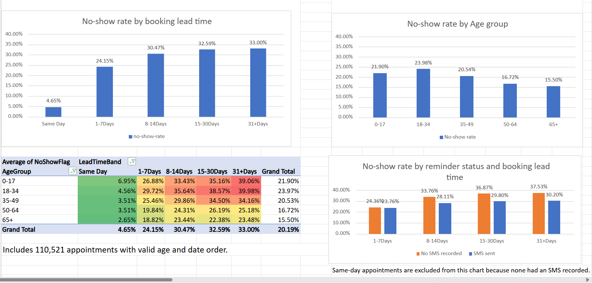

# Healthcare Appointment Attendance Analysis

An Excel portfolio project covering data cleaning, exploratory analysis, dashboard building, and management reporting using 110,527 medical appointments.

## Dashboard

[Download the Excel workbook](excel/Appointment_Analysis.xlsx)

## Business questions

- How does appointment attendance vary by booking lead time and age?
- Does the SMS reminder comparison change when appointments are grouped by lead time?
- Which patterns warrant further operational investigation?

## Key results

| Metric | Result |
|---|---:|
| Total appointments | 110,527 |
| Attended | 88,208 |
| Missed | 22,319 |
| Overall no-show rate | 20.19% |

- **Booking lead time:** No-show rates ranged from 4.65% for same-day appointments to 33.00% for bookings made 31+ days ahead.
- **Missed volume:** The 1–7-day booking group contributed the most missed appointments: 7,772.
- **Age:** Ages 18–34 had the highest overall no-show rate, at 23.98%, compared with 15.50% for ages 65+.
- **Age within lead-time bands:** Ages 18–34 had the highest rate in every advance-booking band. Ages 0–17 had the highest same-day rate.

### Why the SMS comparison needed more investigation

Overall, the SMS-sent group had a higher no-show rate: **27.57% versus 16.70%** for appointments without SMS recorded.

However, the SMS-sent group had a **lower rate within every advance-booking band**:

| Booking lead time | No SMS recorded | SMS sent |
|---|---:|---:|
| 1–7 days | 24.36% | 23.76% |
| 8–14 days | 33.76% | 28.11% |
| 15–30 days | 36.87% | 29.80% |
| 31+ days | 37.53% | 30.20% |

All 38,563 same-day appointments had no SMS recorded. Their low no-show rate of 4.65% lowered that group’s overall average.

This illustrates how differences in group composition can reverse an overall comparison. It does not prove that SMS reminders caused better attendance.

## Tools and skills

**Microsoft Excel**

- Structured tables and formulas
- Data-type standardization and validation checks
- Data-quality flags and documented exclusions
- PivotTables and subgroup comparisons
- Linked charts and conditional-formatting heatmaps
- Dashboard design and plain-language reporting

## Data cleaning and preparation

| Area | Treatment |
|---|---|
| Identifiers | Stored PatientId and AppointmentID as text |
| Missing values | Checked the original CSV; no blank or whitespace-only cells found |
| Duplicates | Found no duplicate AppointmentIDs or exact duplicate rows; retained repeated patients |
| Column headings | Renamed Hipertension to Hypertension and Handcap to DisabilityCode |
| Text quality | Found no leading/trailing whitespace; preserved neighborhood names and accents |
| Dates | Created formula-based date-only fields while preserving original timestamps |
| Booking lead time | Used calendar-date differences to avoid false negative intervals for same-day bookings |
| Invalid dates | Flagged five appointments that preceded their booking dates |
| Age validation | Flagged one negative age and seven ages above 100; retained high ages provisionally |
| Age zero | Retained 3,539 records that may represent infants |
| Attendance | Created readable attendance labels and a 0/1 NoShowFlag |
| SMS | Created ReminderStatus while preserving SMS_received |
| Disability coding | Preserved codes 0–4; excluded the field from analysis because their meanings remain unresolved |

Neighborhood spelling was not independently verified. Renaming DisabilityCode did not establish the meaning of its values.

## Analysis populations

Records were excluded only from analyses affected by their data-quality issues.

| Analysis | Appointments included |
|---|---:|
| Overall attendance and overall SMS comparison | 110,527 |
| Lead-time analysis and SMS comparison by lead time, including same day | 110,522 |
| Age analysis | 110,526 |
| Age × lead-time analysis | 110,521 |

The SMS comparison chart displays only advance bookings because no same-day appointments had SMS recorded.

## Workbook guide

| Sheet | Purpose |
|---|---|
| Dashboard | KPIs, charts, heatmap, and SMS explanation |
| Findings_Report | Findings, proposed actions, and limitations |
| Summary | Supporting PivotTables and chart-source tables |
| Cleaning_Log | Checks, transformations, and exclusions |
| Data_Dictionary | Field meanings, types, and calculation rules |
| Source_and_License | Attribution, source links, and license |
| Working_Data | Working table and calculated fields |
| Raw_Data | Preserved original data |

## How to review and reproduce

1. Download the workbook and open it in Excel.
2. Start with Dashboard, then read Findings_Report.
3. Use Summary to inspect the counts and rates behind the visuals.
4. Review Cleaning_Log and Data_Dictionary for calculation rules.

After refreshing the original dataset, confirm **110,527 appointments**, **22,319 missed**, and a **20.19% no-show rate**.

Some chart and KPI links use fixed cell references. Check those links whenever PivotTable layouts or filters change. Update written findings if the underlying data changes.

## Operational recommendations

- Investigate attendance barriers among advance bookings, including cancellation and rescheduling processes.
- Review reminder assignment and timing, then test proposed changes with a suitable comparison group.
- Consider both missed-appointment counts and rates when prioritizing attention.

These are proposed actions to test. No intervention was implemented or measured in this project.

## Limitations

- Appointment dates cover a short historical period: **29 April–8 June 2016**.
- Some patients have multiple appointments; appointment counts are not unique-patient counts.
- Comparisons are descriptive and do not establish causation.
- Reminder groups were not randomly assigned. Message timing, delivery, and reading are unverified.
- Comparing broad lead-time bands does not account for all differences between groups.
- Seven ages above 100 remain unverified.
- Results should not be assumed to represent current clinic performance.

## Data source and attribution

**Medical Appointment No Shows**, credited to **Joni Hoppen and Aquarela Analytics**.

- [Dataset on Kaggle](https://www.kaggle.com/datasets/joniarroba/noshowappointments)
- [CC BY-NC-SA 4.0 license](https://creativecommons.org/licenses/by-nc-sa/4.0/)

Modifications include identifier formatting, column renaming, date conversion, quality flags, derived categories, attendance and reminder indicators, and analysis-specific exclusions. Summaries, charts, and a dashboard were created from the data.

The source dataset and adaptations of it shared in this project remain subject to **CC BY-NC-SA 4.0**. No endorsement by the creators is implied. Attribution does not grant permission for uses outside the license terms.

## Project type

Independent portfolio project using public data.
